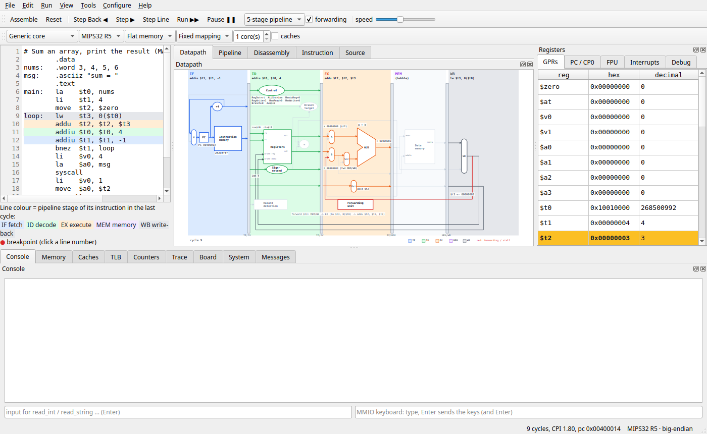
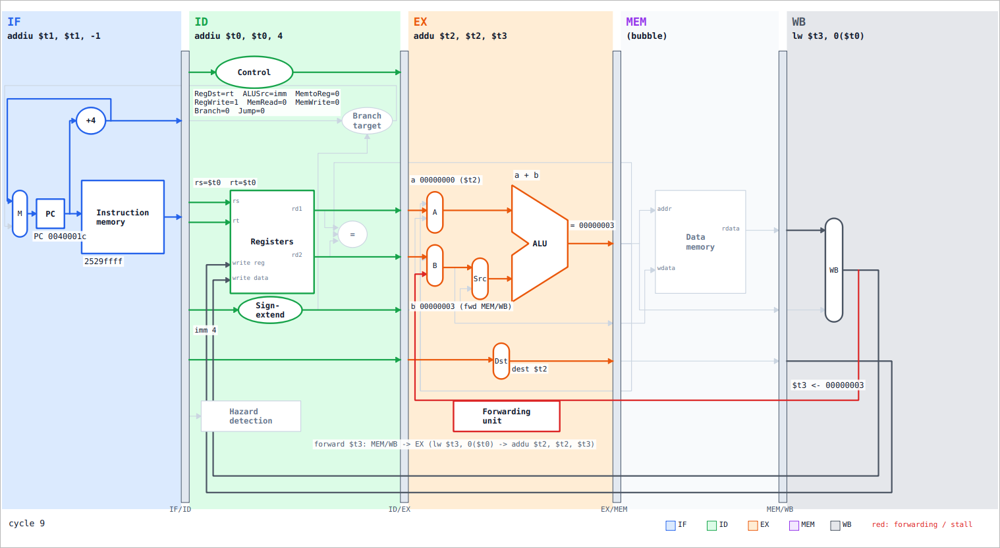
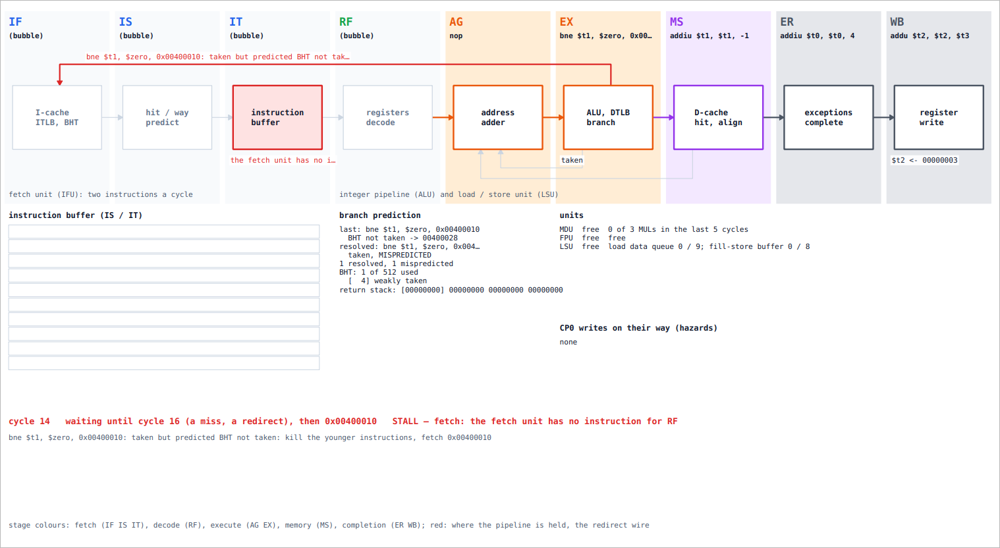

# eMIPS

**A MIPS32 emulator for learning computer architecture.**  Write or load
a program, run it on a model that behaves like a real MIPS32 processor,
and watch what happens inside: how each instruction is decoded, what the
ALU computes, how the pipeline stages overlap, where and why the
pipeline stalls, what the caches and the TLB do, how cores share memory.



The MIPS32 *Architecture for Programmers* manuals are the reference:
eMIPS behaves one to one like a MIPS, and where the manuals leave a
choice open, it says which one it made.

## What you can do with it

- **Write assembly and run it** — an editor with breakpoints, a two-pass
  assembler (GNU as / MARS syntax, pseudo-instructions), a disassembler,
  Intel HEX, ELF executables and C programs with source-level debugging;
  the MARS / SPIM system calls and a memory-mapped console.
- **See inside the processor** — the classic 5-stage datapath drawn live
  (control signals, forwarding, stalls, the ALU down to its gates), the
  pipeline chart, every instruction's bit fields, operands and addresses.
- **Every MIPS32 release, R1 to R6** — the integer instruction set, the
  IEEE 754 FPU, Release 6 compact branches; big and little endian.
- **The privileged architecture** — CP0, exceptions, interrupts
  (compatibility, vectored, EIC), shadow register sets, kernel /
  supervisor / user mode, the timer.
- **The memory system** — L1 / L2 / L3 caches, the write buffer, memory
  timing; the TLB and the other MMUs (BAT, VTLB + FTLB, segmentation
  control, the page table walker).
- **A real core's pipeline** — a model of the MIPS 24K's 8-stage pipeline
  with branch prediction, CP0 hazards and performance counters.
- **More than one core** — up to four cores with coherent caches (MESI),
  memory ordering, the Cluster Power Controller and the Global Interrupt
  Controller.
- **Debugging hardware** — EJTAG Debug Mode, hardware breakpoints, watch
  registers, a probe on the TAP, PC sampling and MIPS Trace.

<p>


</p>

## Running it

You need **Python 3.10 or newer** (on Windows type `py` where this says
`python3`).  The simulator needs nothing else; the window needs **PyQt6**
(or PySide6 — either works).

```bash
git clone https://github.com/protektwar/eMIPS.git
cd eMIPS
```

### Straight from the folder — nothing to install

```bash
python3 -m emips run docs/guide/labs/trace_me.asm    # the terminal works right away
```

For the window, install Qt for Python from your system's packages:

| System | Command |
|---|---|
| Debian / Ubuntu / Mint | `sudo apt install python3-pyqt6` |
| Fedora | `sudo dnf install python3-pyqt6` |
| Arch / Manjaro | `sudo pacman -S python-pyqt6` |

```bash
python3 -m emips gui
```

Run the `python3 -m emips ...` commands from inside the `eMIPS` folder.

### In a virtual environment — any system, with pip

Most Linux distributions refuse `pip install` into the system's Python
(*error: externally-managed-environment*); a virtual environment is the
place for pip — and the way on macOS and Windows:

```bash
python3 -m venv .venv                 # Debian / Ubuntu: sudo apt install python3-venv first
source .venv/bin/activate             # Windows: .venv\Scripts\activate
pip install ".[gui]"                  # eMIPS + PyQt6
emips-gui                             # the window; "emips run prog.asm" in the terminal
```

Activate it again (`source .venv/bin/activate`) in every new terminal.
Already have PyQt6 from your system?  `python3 -m venv
--system-site-packages .venv` lets the environment use it.

### As an application — pipx

```bash
pipx install ".[gui]"                 # Debian / Ubuntu: sudo apt install pipx
emips-gui
```

### First steps

In the window: **File → Examples**, **Step** (F10), **Run** (F5) — and
**Help → User Guide** (F1).  In the terminal:

```bash
python3 -m emips run prog.asm            # run it (system calls + console), show the registers
python3 -m emips asm prog.asm            # the listing: address, word, disassembly, source
python3 -m emips pipe prog.asm --events  # the 5-stage pipeline chart, stalls, forwarding
python3 -m emips debug prog.asm          # the debugger (type help)
python3 -m emips --help                  # everything else
```

(Installed with pip or pipx, `emips` is the same command: `emips run
prog.asm`.)  Options shared by the commands include `--release R1..R6`,
`--little`, `--model 5-stage|24k`, `--caches`, `--mmu tlb`, `--cores N`.

### From Python

```python
from emips import Machine, assemble

prog = assemble("""
        .data
nums:   .word 3, 4, 5
        .text
main:   la    $a0, nums
        lw    $t0, 4($a0)
        addiu $t0, $t0, 10
""")
m = Machine()
prog.load(m)
for _ in range(4):
    m.step()
print(m.read_reg(8))         # 14
```

## The user guide

[**docs/guide/index.html**](docs/guide/index.html) — open it in a web
browser, or in eMIPS with **Help → User Guide** (F1).  Six phases: getting
started, writing programs, the window in depth, the command line, the
computer architecture behind every number on the screen (with 29 labs
you check with eMIPS itself), and a reference.

## Author

**Alexandru Herlas** — [github.com/protektwar](https://github.com/protektwar)
(45262264+protektwar@users.noreply.github.com)

eMIPS began in 2021 as a Ruby library and a Discord bot; in 2026 it was
rewritten in Python and grew into this teaching emulator.  It was
developed with the help of Claude (Anthropic), used as an AI programming
assistant.

## License

GPL-3.0-or-later — see [LICENSE](LICENSE).  Copyright © 2021–2026
Alexandru Herlas.
